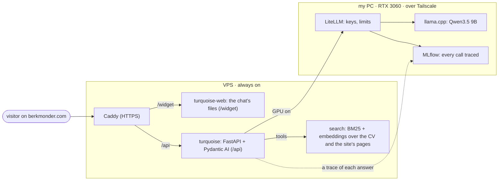

# Turquoise

**The assistant on my website**, [berkmonder.com](https://berkmonder.com). It's the chat in the corner of
every page, and full-size at [berkmonder.com/turquoise](https://berkmonder.com/turquoise/). It answers
questions about the page you're on, the site's lessons and posts, and me.

- **An agent with tools and RAG.** Built with [Pydantic AI](https://ai.pydantic.dev). It reads the page
  you're on, searches the site and my CV, checks what's up, and answers from what it found.
- **It shows its work.** The chat streams every step: the model's thinking, each tool call with what came
  back, then the answer. Thinking and tool calls are collapsed lines you can open, as in a coding agent.
- **On my own GPU.** The model (Qwen3.5 9B) runs on my PC behind LiteLLM. When the PC is off or busy,
  the same agent gives quick answers from search alone, and says so.
- **Every answer is a trace in MLflow** on my PC: each step and tool call, the conversation it belongs to,
  the prompt's version and the build that answered. Where to look: [In MLflow](#in-mlflow).

## How it works

Two machines:

- **The API** runs on my VPS, next to berkmonder.com. It's small (2 vCPU, 4 GB) and always on.
- **The model** runs on my PC, which has an RTX 3060 and is often off or busy with a game.

The site must never break because of the PC.



**One answer:**

1. The chat posts the conversation to `/api/chat`, with the page's path in `X-Turquoise-Page`.
2. The API checks the visitor's limit, then whether the GPU can take it. Is the PC there? Is today's GPU
   budget left? Is there a free slot? Others queue for up to 25 seconds.
3. Pydantic AI runs the agent and streams it back in the Vercel AI SDK's message format
   (`VercelAIAdapter`). The model usually searches first, sometimes twice, then answers from what it found.
4. The chat (`useChat`) shows each step as it arrives.

**The tools** (in `backend/app/agent.py`):

| Tool | What it returns |
|---|---|
| `read_page()` | the page the visitor is on, cut into sections. It's how "summarize this page" works |
| `search_site(query)` | sections of any page on berkmonder.com, with their URLs, so answers link to them |
| `search_profile(query)` | sections of my CV |
| `get_status()` | whether the GPU is on, and whether my sites are up (Upptime's `summary.json` in github.com/berkmonder/status) |

**Where the knowledge comes from:** `app/site.py` reads two things from the website at startup and every
hour, so a new page, post or CV change shows up in the chat without a deploy here:

- the CV, `/files/cv.md` (berkmonder.com's `cv/cv.md`);
- every page in the sitemap, cut at its headings.

Both searches match a question by words (BM25) and by meaning (bge-small embeddings, on the VPS's CPU),
and merge the two rankings (reciprocal rank fusion).

**When the GPU can't answer:** `app/gpu.py` checks LiteLLM's `/health/readiness` every 5 seconds. The
agent switches to a stand-in model (`quick_model`, a Pydantic AI `FunctionModel`) when:

- the PC doesn't answer (it counts as off at once, without waiting for a timeout);
- today's budget is used up;
- the queue is full.

The stand-in runs the same searches and answers with what they found, quoted, saying why. If the GPU fails
mid-answer, a `FallbackModel` hands over to the stand-in.

**Limits** (in `backend/app/config.py`), all in memory, since turquoise runs as one process:

| Limit | Value |
|---|---|
| per visitor | 10 messages in 5 minutes |
| GPU, per day | 500 answers |
| GPU, at once | 3 conversations (LiteLLM's key allows 3; llama.cpp has 4 slots, so one stays free for me) |
| per answer | 6 model calls, tool rounds included |
| per message | 800 characters, and 24 messages of history |

Nothing is stored on the VPS. MLflow, on the PC, keeps the record twice: turquoise's own trace of each
answer (`app/tracing.py`, below), and LiteLLM's trace of each model call.

## In MLflow

http://blackmesa:5000 (my devices, over Tailscale), experiment **`turquoise`**. `app/tracing.py` connects
when MLflow answers, then:

| MLflow's page | What turquoise puts there |
|---|---|
| **Traces** | one per answer: the agent's run, each model call (with its thinking and tokens), each tool call with what it returned. Tags: `answer` (`gpu`, or why it was a quick answer) and `page` |
| **Sessions** | the conversation: the chat's id (`useChat` makes one per conversation). Nothing identifies the visitor |
| **Prompts** | `turquoise-instructions`: `INSTRUCTIONS` from `agent.py`, a new version whenever they change (registered at startup; git stays where they're written) |
| **Agent versions** | `turquoise-<commit>`: each build, linked to its prompt version; every trace says which build answered |

With the PC off, nothing is sent and the chat doesn't wait. Answers given because the PC is off aren't
traced (nowhere to send them); a trace that fails on the way is dropped.

To improve an answer, use **Evaluation**:

- **Judges** score traces against instructions you write, also on every new one. Example: "answers in
  the visitor's language", "only says what the tool results say".
- **Review** and **Datasets:** mark good and bad answers, and gather questions into a dataset.
- **Evaluation runs:** run a dataset against a changed prompt, then compare the two runs.

## The files

| Path | What |
|---|---|
| `backend/app/agent.py` | the agent: its instructions (`INSTRUCTIONS`), its tools, and its two models (the GPU, and the quick-answer stand-in) |
| `backend/app/main.py` | the API: `POST /api/chat` (limits, the GPU queue, then the agent's stream), `GET /api/status`, `GET /api/health` |
| `backend/app/config.py` | every setting and limit, read from the environment |
| `backend/app/search.py`, `site.py` | the RAG: reading the site and the CV, cutting them into sections, searching them |
| `backend/app/tracing.py` | the traces in MLflow: connecting when the PC answers, the prompt's versions, the build, each answer's session and tags |
| `backend/app/gpu.py`, `queue.py`, `limits.py`, `state.py` | is the GPU there; the GPU queue; per-visitor limits; the shared state |
| `backend/tests/` | pytest; `cv.md` is a copy of my CV used only by the tests |
| `frontend/src/` | the chat (React and the AI SDK's `useChat`), built into one script: `/widget/turquoise.js`. `page.ts` holds its words in both languages, including each tool's label |
| `backend/Containerfile`, `frontend/Containerfile` | the two images: the API (Python), and the chat's files (served by Caddy, `frontend/Caddyfile`) |
| `.github/workflows/` | `api.yml` and `web.yml`: checks, then on `main` build, smoke-test and publish the images |

## Settings

| Variable | Default | On the VPS |
|---|---|---|
| `LLM_URL` | empty: quick answers only | `http://100.76.197.63:8000`, the PC's LiteLLM (nix-dotfiles `hosts/vps/apps.nix`) |
| `LLM_KEY` | empty | turquoise's key at LiteLLM: the secret `turquoise-env` (nix-dotfiles `hosts/vps/secrets.yaml`; the same key is `litellm-key-turquoise` in `hosts/desktop/secrets.yaml`) |
| `LLM_MODEL` | `default` | the default: LiteLLM's alias for whichever model the PC serves |
| `SITE_URL` | `https://berkmonder.com` | the default. Locally, `http://localhost:4321` searches a local copy of the site |
| `MLFLOW_TRACKING_URI` | empty: no traces | `http://100.76.197.63:5000`, the PC's MLflow (nix-dotfiles `hosts/vps/apps.nix`) |
| `GIT_COMMIT` | `dev` | the image's commit (CI passes it): the agent version's name |

The limits are settings too (`backend/app/config.py`): `GPU_CHATS_PER_DAY=200`, for example.

## Run it locally

```bash
cd backend && uv sync && uv run uvicorn app.main:app --port 8000   # settings: ../.env.example
cd frontend && npm install && npm run dev                            # http://localhost:5173: a playground
```

The playground shows the chat inline; `?bubble` shows it as the corner button. Without `LLM_URL` and
`LLM_KEY` every answer is a quick answer. Checks, as CI runs them:

```bash
cd backend && uvx ruff check . && uvx ty check . && uv run pytest -q
cd frontend && npm run build
```

## Change it

| To… | Do this |
|---|---|
| change what it says, or how | `INSTRUCTIONS` in `backend/app/agent.py`. After the deploy, MLflow shows it as the prompt's next version, so you can compare answers before and after |
| add a tool | a typed function with a docstring in `agent.py`, under `@agent.tool_plain` (the model sees both). Give it labels in `frontend/src/page.ts` (`tools`), in both languages |
| change a limit | its setting in `backend/app/config.py`, or an environment variable on the VPS |
| change what it knows about me | `cv/cv.md` in berkmonder.com: turquoise reads it within the hour |
| change the chat's look | `frontend/src/chat.css`. It takes its colors and fonts from the page (Starlight's variables) |

## Put it on a page

```html
<script type="module" src="/widget/turquoise.js"></script>
```

That's the bottom-right button. To use it on a page:

- **Show it inline:** a `<div data-turquoise-inline></div>` puts the chat there instead of the button.
- **Open it from a link:** any link to `#ask` opens the button's chat.
- **It adapts to the page:** language from `<html lang>` (Turkish or English), colors and fonts from the page.
- **It calls the page's own domain:** `/api`, saying which page it's on.

A page can set the button's label and the suggested questions:

```html
<meta name="turquoise:label" content="Ask about Berk">
<meta name="turquoise:suggestions" content="First question|Second question|Third question">
```

## Deploy

Push to `main`:

1. CI checks it (ruff, ty, tests; type-check and build).
2. It builds the images, starts each one and checks it answers.
3. It publishes them to GitHub's registry (`ghcr.io/berkmonder/turquoise`, `turquoise-web`).
4. The VPS runs each new version within about 4 minutes. It goes back to the previous image if the new one
   isn't healthy, and my phone hears.

On the VPS (nix-dotfiles `hosts/vps/apps.nix`), berkmonder.com sends `/api` to the API (port 8083) and
`/widget` to the chat's files (port 8084). turquoise.berkmonder.com, its old address, redirects to
berkmonder.com/turquoise. Logs: `ssh vps journalctl -u turquoise -f`.

## Why these parts

- **Pydantic AI:**
  - typed tools from plain functions;
  - streaming of every step;
  - a stand-in model, for the tests and the quick answers;
  - an adapter for the AI SDK's chat format.

  Small enough to read.
- **The Vercel AI SDK's format and `useChat`:** the standard way a chat front end reads an agent's stream,
  so there's no hand-written parser.
- **One script for the chat:** berkmonder.com stays a static site; the chat is its own app with its own
  deploy, embedded with one `<script>`.
