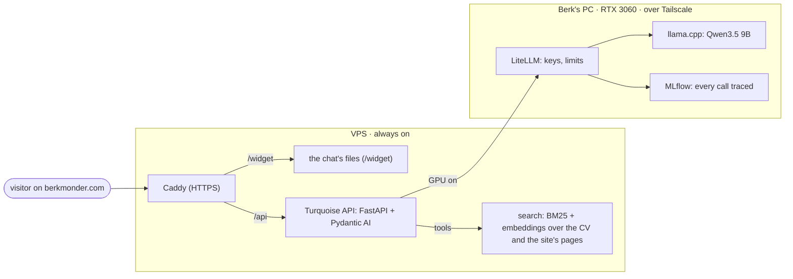

# How turquoise works

Two machines. The API runs on a small, always-on VPS (2 vCPU, 4 GB) next to berkmonder.com. The model
runs on Berk's PC, which has an RTX 3060 and is often off, asleep or busy with a game. The site must
never break because of the PC, so the agent can also answer without the model, from search alone, and
says so.

## One answer

1. The chat (`frontend/`, the Vercel AI SDK's `useChat`) posts the conversation to `/api/chat`.
2. The API checks the visitor's limit, then whether the GPU can take it: is the PC there, is today's
   GPU budget left, is there a free slot (the engine answers a few conversations at once; others queue
   for up to 25 seconds).
3. Pydantic AI runs the agent and streams it back in the AI SDK's message format (`VercelAIAdapter`):
   the model's thinking, each tool call and its result, then the answer. The model usually searches
   first, sometimes twice, and answers from what it found.
4. The chat shows each step as it arrives: thinking and tool calls as collapsed lines (open them to see
   the thought, or the sections a search returned), the answer as markdown.

## The tools

- `read_page()`: the page the visitor is on. The chat sends its path with every question
  (`X-Turquoise-Page`); the agent is told which page it is, and this tool returns that page's sections from
  the website's index. It's how "summarize this page" works.
- `search_profile(query)`: Berk's CV (`backend/profile/cv.md`), cut into sections at its headings.
- `search_site(query)`: berkmonder.com. `app/site.py` reads the sitemap at startup and every hour,
  takes each page's main text and cuts it at its headings, so a new page or blog post is searchable
  without a deploy. Results carry the page's URL, and answers link to it.
- `get_status()`: whether the GPU is on, and whether the sites are up (Upptime's checks).

Both searches match a question two ways, by words (BM25) and by meaning (bge-small sentence embeddings
on the VPS's CPU), and merge the rankings (reciprocal rank fusion).

## When the GPU can't answer

`app/gpu.py` checks LiteLLM's `/health/readiness` every 5 seconds over Tailscale; when it doesn't answer,
the GPU counts as off at once, with no waiting for a timeout. Then, or when the budget is used up or the
queue is full, the agent runs on a stand-in model (`quick_model` in `app/agent.py`, a Pydantic AI
`FunctionModel`). It calls the same two searches and answers with what they found, quoted, saying why.
The chat looks the same: the searches show as steps. If the GPU fails in the middle of an answer, a
`FallbackModel` hands over to the stand-in.

## Limits

Per visitor, 10 messages in 5 minutes; per day, 500 answers on the GPU; per answer, 6 model calls (tool
rounds included); per message, 800 characters and 24 messages of history. All in memory: turquoise runs
as one process. Nothing is stored on the VPS; LiteLLM's traces in MLflow (on the PC) are the record of
what the model was asked and said.

## Why these parts

- **Pydantic AI:** typed tools from plain functions, streaming of every step, a stand-in model for tests
  and the quick answers, and an adapter for the AI SDK's chat format. Small enough to read.
- **The Vercel AI SDK's format and `useChat`:** the standard way a chat front end reads an agent's
  stream, so the chat has no hand-written parser.
- **One script for the chat:** berkmonder.com stays a static site; the chat is its own app with its own
  deploy, embedded with one `<script>`.
