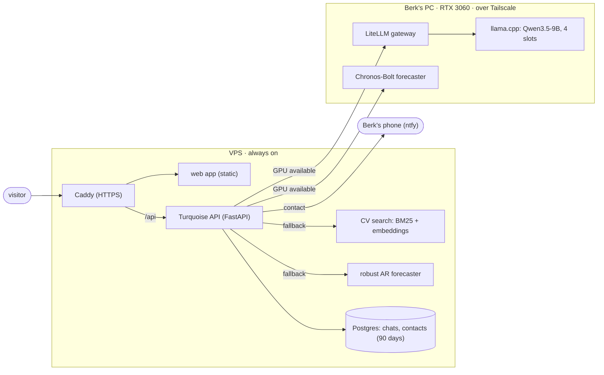

# How turquoise works

Two machines. The site and its API run on a small, always-on VPS (2 vCPU, 4 GB). Heavy work runs on
Berk's PC, which has an RTX 3060 and is often off, asleep or busy with a game. The site must never be
down because of the PC, so every GPU feature has a fallback on the VPS, and every answer says which one
served it.

## Is the GPU there?

`app/gpu.py` checks each GPU service (the gateway, the forecaster) every 5 seconds over Tailscale. A
service that doesn't answer is *offline*: requests go to the fallback at once, with no waiting for a
timeout. Two failed requests in a row also take it offline for 30 seconds, which covers the case where
the gateway answers but the engine behind it is down (a fine-tune, a restart). Both states show on the
site (the "GPU online / offline" pill) and in the pipeline panel.

## Demo 1: the agent

- **Knowledge:** `backend/profile/cv.md` and the rules in `app/chat/prompt.py` go with every request:
  answer only from the CV, say "I don't know" otherwise, talk only about Berk, and suggest "Contact
  Berk" to anyone interested. A CV fits in the prompt, so there is no retrieval step on the GPU path,
  and the engine's prompt cache makes the repeated prefix cheap.
- **Many visitors at once:** llama.cpp runs 4 parallel slots that decode together, one batch per
  step (continuous batching); turquoise uses 3 and leaves one for Berk. Six simultaneous chats measured:
  three answered together in about 3.5 s, three queued and done by 6.5 s, all on the GPU. Beyond that,
  `app/chat/queue.py` keeps a first-come-first-served line (up to 12) and streams each visitor's place.
  A turn that doesn't come within 25 seconds goes to the fallback.
- **The fallback:** no language model. The CV is cut into sections at its headings; a question is
  ranked against them by words (BM25) and by meaning (bge-small sentence embeddings, ONNX on the CPU),
  and the two rankings are merged with reciprocal rank fusion. The best sections are shown as they
  are, with why the GPU didn't answer.
- **Limits:** 10 messages per visitor per 5 minutes, 800 characters each, a daily GPU budget for
  everyone (500), and a gateway key that can use only this one model. The gateway is asked not to
  log; turquoise keeps conversations for 90 days, as the notice under the chat says, then deletes them.
- **Contact:** name, email and a message are stored (90 days) and sent to Berk's phone through ntfy.

## Demo 2: anomaly detection

- **The signal** (`app/anomaly/engine.py`): three sines whose periods relate by the golden ratio, so
  it never repeats, plus a slow Ornstein-Uhlenbeck wander. Four points a second, the same stream for
  everyone (server-sent events).
- **The band:** every second the last 64 seconds are forecast 16 seconds ahead, with an uncertainty
  for each step. On the GPU, Chronos-Bolt (a pretrained time-series model) returns quantiles; the
  fallback is an AR(12) refitted every second by iteratively reweighted least squares (Huber weights, so
  outliers barely count), whose band is the wider of its theoretical spread and the errors it really
  made forecasting its own recent past. Each moment keeps the last forecast made before it.
- **Detection:** a visitor's point is scored against the band the model had for that moment:
  z = (value − expected) / σ, an anomaly beyond 3σ. σ never drops below a click's precision. A point
  placed in the forecast zone waits (shown hollow) until its moment comes, then is judged against the
  last band drawn before it. Only visitors' points are judged, never the generated signal.
- **For anyone's data** (`POST /api/v1/anomaly/detect`): each point is compared with a forecast made
  from the points before it (64 points of warm-up). On the GPU all windows go to Chronos-Bolt in one
  batch; on the CPU the series is processed in order and each anomaly is clipped to the band's edge in
  the history the next forecasts learn from, so one spike doesn't make its neighbours look odd too.

## The pipeline panel

Every step of every request is an event (`app/events.py`): which stage, how long it took, no content.
`GET /api/live` streams them to everyone watching, with a status snapshot every few seconds;
`frontend/src/components/Pipeline.tsx` draws each request as a pulse moving through the diagram (your
own are brighter), and `frontend/src/pipelines.ts` explains each box.

## Running it

One process (uvicorn): the queue, the rate limits and the live feed are in memory. CI publishes each
image to GitHub's registry; the VPS copies new versions into its own registry, Podman there updates
within a few minutes and rolls back an image that doesn't get healthy. Health is `GET /api/health`; the VPS and an outside check (Upptime) watch it.
